  

<h3><code>refael@github ~ $ ./links.sh</code></h3>

 

## 👋 קצת עליי

אני עובד עם סוכני בינה מלאכותית בפיתוח תוכנה, לפי שיטה קבועה:

- 🧭 **אני מחליט**, הסוכן מבצע
- 🔒 **כל החלטה** נרשמת וננעלת
- ✅ **שום משימה** לא נסגרת בלי הוכחה

### 🛠️ מה עוד אני בונה

- ⚙️ כלי DevOps עם בדיקות אוטומטיות ו-Pipeline מלא
- 🐳 Docker Container: סריקת אבטחה, Images, כיסוי בדיקות מלא
- 🔁 Jenkins and GitHub Actions, מתחילת הפיתוח ועד הפריסה לפרודקשן.

  
  
  

 

## 🚀 `ls ~/projects`

> 🟢 Released or complete 
> 🟡 In development 
> 🔵 Public showcase of a private codebase

### 📈 Trading Systems

| | Project | What it does | Stack |
| :-: | :-- | :-- | :-- |
| 🟡 | [**Gold_BOT_Alaret**](https://github.com/www8351/Gold_BOT_Alaret) | XAUUSD signal engine on ICT Quarterly Theory | `Python` |
| 🟡 | [**Agent-AI**](https://github.com/www8351/Agent-AI) | Market intelligence for futures, gold and crypto, advisory only | `Python` |
| 🟢 | [**AccountGuardian**](https://github.com/www8351/AccountGuardian-Release) | Locks the whole MT5 account at its daily loss limit | `MQL5` |
| 🟢 | [**Account_Guardian-V1**](https://github.com/www8351/Account_Guardian-V1) | Source of the released guardian, with spec, test vectors and evidence | `MQL5` `PowerShell` |
| 🟡 | [**Account_Guardian_V2**](https://github.com/www8351/Account_Guardian_V2) | Next guardian version, adds an equity peak floor | `MQL5` |

### 🌐 Full-Stack SaaS

| | Project | What it does | Stack |
| :-: | :-- | :-- | :-- |
| 🔵 | [**Vertex_Command_Showcase**](https://github.com/www8351/Vertex_Command_Showcase) | Copy trading and trade execution platform | `TS` `Python` |
| 🟡 | [**Syncer_Q**](https://github.com/www8351/Syncer_Q) | The same platform, packaged for deployment | `TS` `Python` |
| 🔵 | [**Trades_Journal**](https://github.com/www8351/Trades_Journal) | Trading journal rebuilt from raw executions | `TS` |
| 🟢 | [**Tradezella-Example**](https://github.com/www8351/Tradezella-Example) | The journal as a full build, deployed on Vercel | `TS` |

### 🛠️ DevOps & Systems

| | Project | What it does | Stack |
| :-: | :-- | :-- | :-- |
| 🟢 | [**Docker-DevOps-Tooling**](https://github.com/www8351/Docker-DevOps-Tooling) | Typed Docker CLI with signed, scanned images | `Python` |
| 🟢 | [**Linux-Hardening-and-System**](https://github.com/www8351/Linux-Hardening-and-System) | Safe, testable CLI replacing admin shell scripts | `Python` |
| 🟢 | [**Build-Test-Deploy**](https://github.com/www8351/Build-Test-Deploy) | DevOps lab from shell menus to a Jenkins pipeline | `Python` `Shell` |
| 🟢 | [**5-DevOps-Toolkit**](https://github.com/www8351/5-DevOps-Toolkit) | Linux, Docker and AWS tools on one shared engine | `Shell` `Python` |
| 🟡 | [**Active_Directory**](https://github.com/www8351/Active_Directory) | Scripts for local users, groups and folder rights | `PowerShell` `Shell` |

### 🧰 Tools & Teaching

| | Project | What it does | Stack |
| :-: | :-- | :-- | :-- |
| 🟢 | [**Python-Mentoring-Labs**](https://github.com/www8351/Python-Mentoring-Labs-for-Junior-Engineers) | Seven labs from beginner scripts to tested code | `Python` |
| 🟢 | [**Claude_Quota_Line**](https://github.com/www8351/Claude_Quota_Line) | Terminal status line for usage limits | `PowerShell` |
| 🟢 | [**Kickoff**](https://github.com/www8351/Kickoff) | One command to set up a Claude Code workspace | `PowerShell` |

🔒 Two private repositories: <b>Vertex_Command</b>, the production codebase behind the showcases, and <b>The-Binary-Ledger</b>, a Knesset voting-transparency index.

 

## 🧪 `./run-tests --all`

| 🧪 Project | Tests | Coverage | Gate |
| :-- | :-: | :-: | :-- |
| Linux-Hardening-and-System | **206** | 82% | mypy strict |
| Agent-AI | **198** | 99 to 100% | mypy strict, 95% gate |
| Gold_BOT_Alaret | **143** | | pytest |
| 5-DevOps-Toolkit | **53** | | bats + pytest, 5 CI checks |
| Trades_Journal · Tradezella | **48** | | vitest |
| Docker-DevOps-Tooling | **45** | **100%** | mypy strict, Trivy |
| Build-Test-Deploy | **40 + 16** | 93% | pytest + bats |

 

## 🛠️ `cat stack.txt`

| | |
| :-- | :-- |
| 💬 **Languages** |       |
| 🌐 **Frontend & SaaS** |       |
| ⚙️ **Backend & Realtime** |        |
| ☁️ **DevOps & Cloud** |       |
| 🔭 **Observability** |      |
| 🛡️ **Security** |         |
| ✅ **Quality** |        |
| 📈 **Trading** |         |

 

## 🎯 `man refael`

| | Principle | In practice |
| :-: | :-- | :-- |
| 🧱 | **Pure core** | Logic stays free of I/O, so it runs without a broker, a socket or a VM |
| 🔐 | **Security first** | `.env.example` only, credentials encrypted at rest, real-money paths off by default |
| 🧪 | **Verifiable** | Strict typing, coverage-gated suites, CI that blocks every push |
| 📝 | **Honest docs** | Each README says what the build does not do yet |

 

<code>refael@github ~ $ exit</code>

